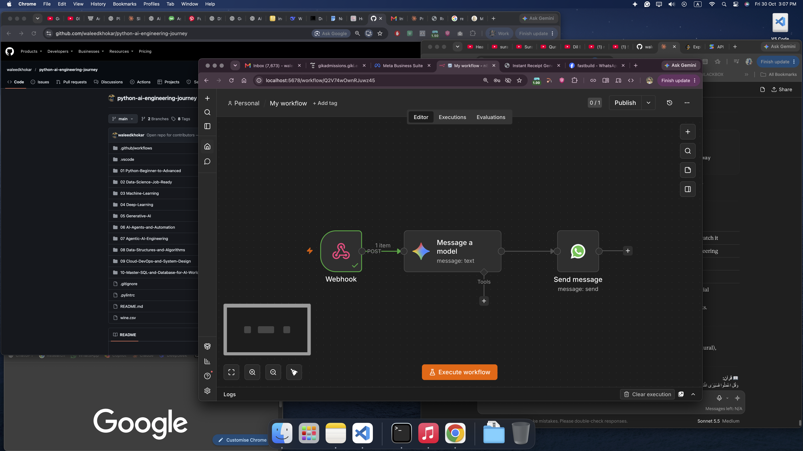
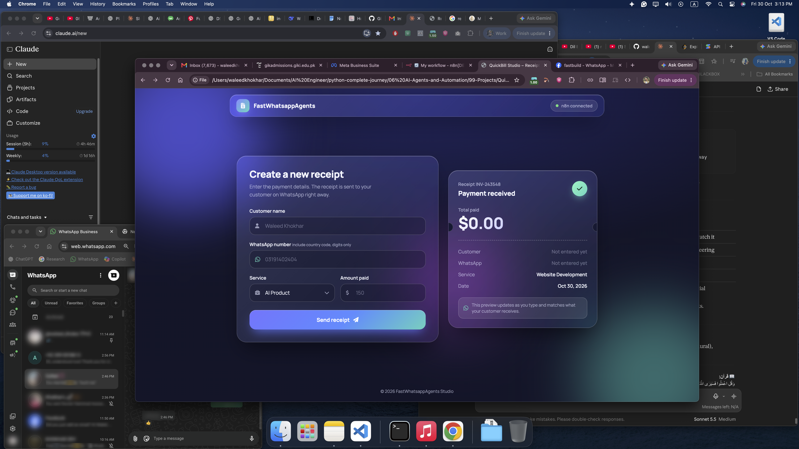

<div align="center">

# 🤖 WhatsApp Business AI Agent

A free, self-hosted AI customer-support agent that connects WhatsApp to a local AI model — answers from your knowledge base, looks up order data, and hands off to a human when unsure.

</div>

---

## 🚀 About This Agent

**WhatsApp Business AI Agent** is a production-ready automation workflow that turns WhatsApp into an intelligent customer-support channel.

Customers message your WhatsApp number. The agent understands what they need, searches your knowledge base for answers, checks real order data in your database, and replies instantly. If it is not confident, it hands the conversation to a human staff member.

The agent remembers each customer, protects against duplicate messages, logs every conversation, and follows WhatsApp's official rules for business messaging.

**How it works:**

```
Customer message → WhatsApp Cloud API webhook → n8n
   → classify intent → [FAQ via RAG | order lookup in DB | escalate]
   → reply via WhatsApp API → log everything in PostgreSQL
```

---

## 💡 Why It's Helpful

- 💬 **Always-on support** — answers customers 24/7 without hiring a support team
- 📚 **Answers from your own data** — uses RAG over your docs, not generic AI guesses
- 📦 **Real order updates** — checks PostgreSQL to give accurate order status
- 🙋 **Smart handoff** — knows when to escalate to a human instead of guessing
- 🛡️ **Safe and reliable** — duplicate-message protection, retry handling, and full audit logs
- 💸 **Free to run** — self-hosted n8n, free Gemini API tier, open-source stack
- 🔧 **Customizable** — swap the LLM, add tools, connect any database

---

## 🛠 Tech Stack

<div align="center">


</div>

## 📸 Screenshots

| AI Agent N8N | Web Page View|
| :---: | :---: |
|  |  |

---


| Layer | Tool |
|---|---|
| Orchestration | n8n (self-hosted) |
| LLM | Google Gemini (`gemini-3.8-flash`) |
| Messaging | WhatsApp Business Cloud API |
| Database | PostgreSQL |
| Vector store | ChromaDB / pgvector |
| Runtime | Node.js 20.19+ |

---

## 👨‍💻 Developer

**Waleed Khokhar** — *Full-Stack AI Engineer*

Full-Stack Developer with 1+ year of experience building scalable **web applications** and **mobile apps (Android & iOS)** with AI-powered features. Specializing in intelligent AI solutions using **Generative AI, LLMs, Agentic AI, RAG, and LangChain automation**, alongside strong proficiency in **React Native, Next.js, Python & FastAPI, and the MERN stack** for building modern, production-ready mobile & web apps.

[](https://waledkhokar.vercel.app/)
[](https://linkedin.com/in/waleedkhokhar)
[](https://github.com/waleedkhokhar)


⭐ **If you liked this project, drop a ⭐ on the repo and share it with others!**